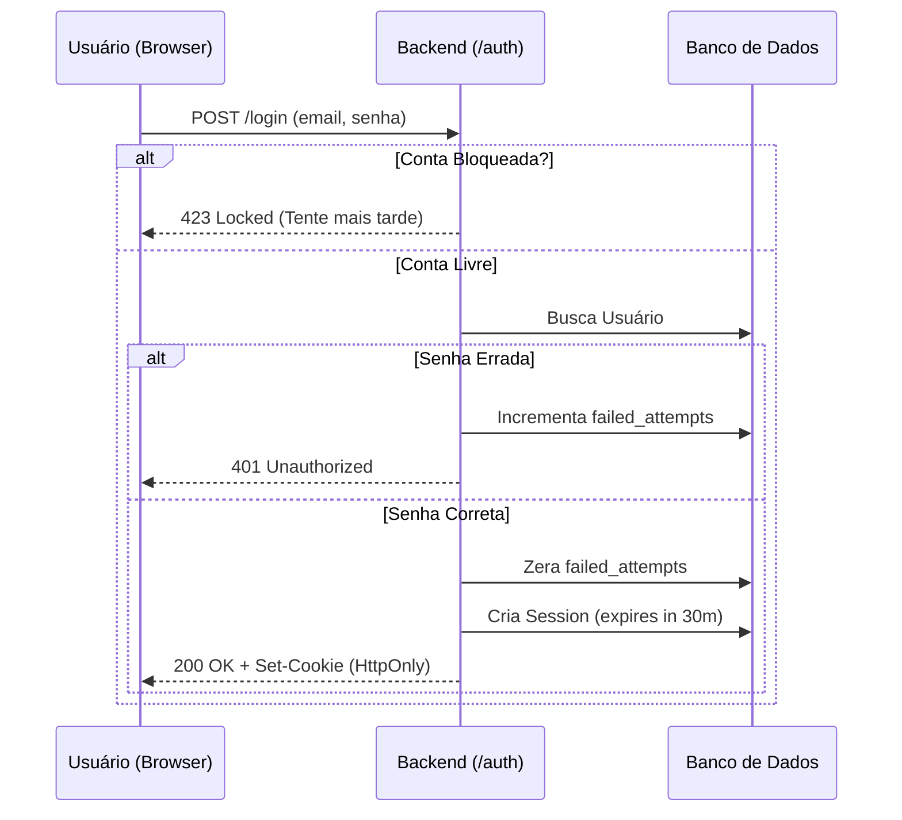

# Arquitetura de Autenticação e Sessão

Este documento detalha o funcionamento, as decisões técnicas e as diretrizes de segurança adotadas para o sistema de autenticação, focado na gestão de sessão e proteção contra força bruta.

## 1. Visão Geral
O sistema utiliza autenticação baseada em tokens de sessão opacos armazenados no servidor (banco de dados), acompanhados de medidas rigorosas contra ataques de força bruta, alinhados com a LGPD e boas práticas de Segurança da Informação.

## 2. Decisões Técnicas e Justificativas (Segurança)

### Por que usar Sessão no Banco de Dados em vez de JWT?
Foi decidido **não utilizar JSON Web Tokens (JWT)** para a gestão da sessão final.
- **Justificativa:** O JWT é *stateless* (sem estado). Se um token JWT for roubado, o servidor não consegue revogá-lo imediatamente, abrindo brecha para sequestro de sessão até que o token expire naturalmente.
- **Nossa solução:** Usamos um token opaco gerado por `secrets.token_urlsafe(32)`. O token fica salvo no banco de dados (`table sessions`). Quando o usuário faz logout, nós preenchemos o campo `revoked_at` no banco, invalidando a sessão **imediatamente**.

### Por que bloquear por tempo (Time-Lock) na Força Bruta?
Se um usuário errar a senha 5 vezes, a conta é bloqueada por 15 minutos.
- **Justificativa:** Evitamos o bloqueio definitivo da conta. Se o bloqueio fosse definitivo, um atacante mal-intencionado poderia travar as contas de usuários legítimos de propósito, gerando um ataque de Negação de Serviço (DoS). O bloqueio temporário atrasa bots sem prejudicar o usuário real de forma permanente. Esta abordagem segue as recomendações da norma **NIST SP 800-63B** sobre a mitigação de ataques de adivinhação de senhas on-line, que recomenda limitar o número de tentativas e aplicar atrasos temporais.

## 3. Gestão de credenciais e criptografia

As senhas dos usuários não são armazenadas em texto puro. O sistema utiliza o algoritmo **bcrypt** para gerar um hash adaptativo das senhas antes de armazená-las no banco de dados. Durante o processo de autenticação, a senha informada pelo usuário é comparada com o hash armazenado, sem que a senha original precise ser recuperada. Conforme descrito por Hintzbergen et al. (2018), em sistemas que exigem confidencialidade e proteção de senhas, a criptografia e o uso de hash (criptografia unidirecional) são contramedidas vitais para proteger dados de acesso e manter a integridade do sistema de informação.

### 3.1. Política de Validação de Senhas e Limite do Bcrypt (72 bytes)

Conforme estabelecido no achado **V19 da Auditoria de Segurança v2.0** e alinhado ao **NIST SP 800-63B**, o Mentory implementa validação estrita de entradas e controle de tamanho de senhas:
- **Comprimento Mínimo:** 8 caracteres, garantindo entropia suficiente contra tentativas de adivinhação.
- **Limite Máximo (72 bytes em UTF-8):** Decorrente da arquitetura interna da cifra Eksblowfish utilizada pelo `bcrypt`.
- **Rejeição Explícita (Sem Truncamento Silencioso):** Senhas com mais de 72 bytes são rejeitadas com HTTP `400 Bad Request` no cadastro e na redefinição. O sistema **não trunca silenciosamente** a entrada, evitando que duas senhas distintas com o mesmo prefixo gerem hashes equivalentes.
- **Tratamento de Exceções sem Erro 500:** No login e nos endpoints autenticados, payloads malformados ou senhas com tamanho excedente são tratados via `safe_check_password()`, retornando HTTP `401 Unauthorized` ou `400 Bad Request` de maneira previsível e sem expor tracebacks ou exceções `500`.

A autenticação de dois fatores (2FA) utiliza **TOTP (Time-based One-Time Password)** como segundo fator de autenticação, seguindo o padrão estabelecido pela **RFC 6238**. O segredo TOTP é cifrado com **Fernet** antes de ser persistido no banco; a chave usada para essa cifragem é a variável `TOTP_ENCRYPTION_KEY`, separada da `SECRET_KEY` e mantida fora do código. Os segredos utilizados pelo TOTP não são registrados nos logs de auditoria em texto claro. Os eventos de sucesso e falha relacionados ao 2FA são registrados para permitir a rastreabilidade das autenticações.

As variáveis `SECRET_KEY` e `TOTP_ENCRYPTION_KEY` são obrigatórias. A aplicação falha no startup quando alguma delas está ausente ou quando a chave Fernet é inválida. Uma chave Fernet pode ser gerada com `python -c "from cryptography.fernet import Fernet; print(Fernet.generate_key().decode())"`.

No processo de recuperação de senha, os tokens são gerados de forma segura, armazenados no banco em formato protegido, possuem prazo de expiração e são invalidados após o uso. Os detalhes desse fluxo estão documentados em [Recuperação de senha](recuperacao-senha.md).

Para informações sobre o estado atual dos mecanismos de criptografia e comunicação segura, incluindo os riscos identificados e o plano de tratamento, consulte a documentação [Análise de Riscos](analise-riscos.md).

## 4. Conformidade com a LGPD

O modelo de dados foi estruturado considerando o **Artigo 18 da LGPD** (Direitos do Titular):
- **Direito à eliminação:** A tabela `sessions` foi configurada com restrição de chave estrangeira `ON DELETE CASCADE` vinculada ao `user_id`. Isso garante que, se um usuário solicitar a exclusão de seus dados pessoais do sistema, todas as suas sessões e históricos associados serão automaticamente expurgados do banco de dados, sem deixar rastros órfãos.
- **Minimização de dados:** O cookie salvo na máquina do usuário contém **apenas** o token opaco (sem armazenar e-mail ou nome no navegador) e usa a flag `HttpOnly` para mitigar ataques XSS.

## 5. Diagrama de Fluxo (Login e Força Bruta)

## Referências
Para consultar as referências bibliográficas, científicas e normativas que fundamentam as decisões deste documento, consulte as **[Referências Técnicas](referencias.md)**.