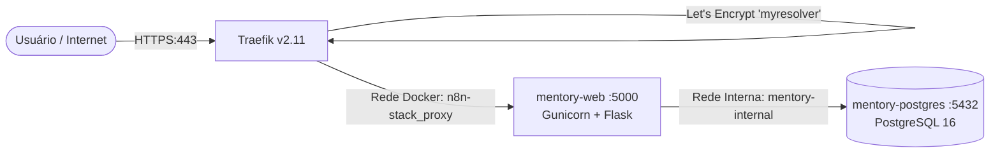

# Guia de Deploy em Produção na VPS (Traefik + GitHub Actions CD)

Este documento detalha a arquitetura de produção do Mentory na VPS Hostinger sob o domínio `mentory.stack-n8n.cloud`, com terminação TLS/HTTPS automática pelo Traefik e deploy contínuo (CD) via GitHub Actions.

---

## 1. Arquitetura de Produção

A infraestrutura na VPS foi projetada para conviver harmoniosamente com outros serviços em execução (como o Traefik v2.11 e o n8n), sem interferir nas portas e sem compartilhar volumes de banco de dados:



### Principais Características
- **Isolamento de Banco de Dados:** O Mentory possui seu próprio container PostgreSQL (`mentory-postgres`) com volume nomeado (`mentory_pgdata`) e rede interna dedicada (`mentory-internal`), sem expor a porta 5432 para o host.
- **Roteamento Inteligente via Traefik:** O container `mentory-web` se conecta à rede externa `n8n-stack_proxy` com as etiquetas (*labels*) `Host(\`mentory.stack-n8n.cloud\`)`, `entrypoints=websecure` e `certresolver=myresolver`. O Traefik emite e renova os certificados SSL/TLS automaticamente via Let's Encrypt.
- **Segurança e Cookies:** A aplicação roda com `SECURE_COOKIES=true` e valida o cabeçalho `X-Forwarded-Proto: https` enviado pelo Traefik.
- **Servidor WSGI de Produção:** A aplicação roda com **Gunicorn** (2 workers) com logs direcionados para stdout/stderr do Docker.

---

## 2. Configuração Inicial na VPS (Passo Único)

Acesse sua VPS via SSH e execute os seguintes passos na primeira vez:

### Passo 2.1: Clonar o repositório
```bash
git clone https://github.com/ProjetoIntegradorUMC/projeto-integrador.git /root/projeto-integrador
cd /root/projeto-integrador
```

### Passo 2.2: Criar e preencher o arquivo `.env.prod`
```bash
cp .env.prod.example .env.prod
nano .env.prod
```

Preencha os valores:
- `DB_ADMIN_PASSWORD`: gere uma senha forte para o admin do banco.
- `DB_APP_PASSWORD`: gere uma senha forte para a aplicação.
- `SECRET_KEY`: chave de 32 bytes gerada via Python:
  ```bash
  python3 -c "import secrets; print(secrets.token_hex(32))"
  ```
- `TOTP_ENCRYPTION_KEY`: chave Fernet gerada via Python:
  ```bash
  python3 -c "from cryptography.fernet import Fernet; print(Fernet.generate_key().decode())"
  ```
- Configure as credenciais de SMTP para envio de e-mails de recuperação.

### Passo 2.3: Iniciar os containers pela primeira vez
```bash
docker compose -f docker-compose.prod.yml up -d --build
```

Verifique se os containers subiram:
```bash
docker ps
```
Você verá `mentory-postgres` e `mentory-web` rodando. Em instantes, o Traefik emitirá o certificado e o sistema estará acessível em `https://mentory.stack-n8n.cloud`.

---

## 3. Configuração do Deploy Automático (GitHub Actions CD)

A cada Pull Request aprovada e mergeada na branch `main`, o GitHub Actions executa os testes automatizados e atualiza a VPS via SSH.

### Configurar Secrets no Repositório do GitHub:
No GitHub, vá em **Settings** > **Secrets and variables** > **Actions** > **New repository secret** e adicione:

1. `VPS_HOST`: `72.62.106.100` (IP da VPS)
2. `VPS_USERNAME`: `root` (ou o usuário com permissão de Docker na VPS)
3. `VPS_SSH_KEY`: Conteúdo da sua chave privada SSH (ex.: `~/.ssh/id_rsa` ou `id_ed25519`).
4. `VPS_PORT`: `22` (opcional, padrão 22).

---

## 4. Fluxo de Atualização Contínua (Zero Toque)

1. Um desenvolvedor abre uma PR com melhorias ou correções.
2. A equipe revisa e aprova a PR.
3. Ao clicar em **Merge pull request** na `main`:
   - O robô do GitHub roda a suíte de testes (`pytest -v`).
   - Se os testes passarem, o robô conecta na VPS via SSH.
   - Atualiza o código (`git pull`) e recria os containers (`docker compose -f docker-compose.prod.yml up -d --build`).
   - O Traefik mantém o tráfego HTTPS sem interrupção.

---

## 5. Modelo de Confiança do `X-Forwarded-Proto` e Evidências de TLS em Produção

### 5.1 Isolamento entre `mentory-internal` e `n8n-stack_proxy` e proteção contra injeção de `X-Forwarded-Proto`
A proteção contra falsificação (*spoofing*) do cabeçalho `X-Forwarded-Proto` em produção baseia-se na combinação entre isolamento de rede Docker no [`docker-compose.prod.yml`](../docker-compose.prod.yml) e validação de salto único no Flask (`ProxyFix` em [`backend/app/__init__.py`](../backend/app/__init__.py)):

1. **Porta `5000` não exposta no host:** O serviço `mentory-web` não possui mapeamento `ports:` para o host da VPS (`72.62.106.100`). A porta `5000` existe apenas no escopo interno dos containers.
2. **Segmentação em duas redes Docker (`mentory-internal` e `n8n-stack_proxy`):**
   - `mentory-internal` (`internal: true`): rede exclusiva para comunicação entre `mentory-web` e `mentory-postgres`, sem roteamento externo.
   - `n8n-stack_proxy` (`external: true`): rede de borda compartilhada apenas com o container do **Traefik v2.11** (`traefik.docker.network=n8n-stack_proxy`).
   - Como consequência, nenhum cliente externo consegue conectar-se diretamente ao Gunicorn (`mentory-web:5000`) para injetar `X-Forwarded-Proto: https` sem passar pelo Traefik.
3. **Configuração de `ProxyFix(app.wsgi_app, x_for=1, x_proto=1)` e `enforce_https()`:**
   - O middleware `ProxyFix` com `x_proto=1` e `x_for=1` instrui o Werkzeug/Flask a confiar exclusivamente no último salto (1 hop), que corresponde ao Traefik v2.11.
   - O hook `@app.before_request` (`enforce_https()`) verifica `if secure_cookies and not request.is_secure:` e aborta com `HTTP 403 Forbidden` qualquer chamada que não tenha sido autenticada via TLS.

### 5.2 Evidência de bloqueio de HTTP em produção (`curl`)
O roteador do Traefik em `docker-compose.prod.yml` opera exclusivamente no entrypoint HTTPS (`entrypoints=websecure`, `tls=true`, `tls.certresolver=myresolver`), rejeitando chamadas HTTP na porta 80 (`404 Not Found`), enquanto chamadas HTTP diretas à aplicação sem TLS recebem `403 Forbidden` de `enforce_https()`:

```text
$ curl -v http://mentory.stack-n8n.cloud
* Host mentory.stack-n8n.cloud:80 was resolved.
* IPv4: 72.62.106.100
* Connected to mentory.stack-n8n.cloud (72.62.106.100) port 80
> GET / HTTP/1.1
> Host: mentory.stack-n8n.cloud
> User-Agent: curl/8.18.0
> Accept: */*
< HTTP/1.1 404 Not Found
< Content-Type: text/plain; charset=utf-8
< X-Content-Type-Options: nosniff
404 page not found
```

```text
$ docker compose -f docker-compose.prod.yml exec -T mentory-web curl -v http://127.0.0.1:5000/
> GET / HTTP/1.1
> Host: 127.0.0.1:5000
< HTTP/1.1 403 FORBIDDEN
< Server: gunicorn/23.0.0
< Strict-Transport-Security: max-age=31536000; includeSubDomains
<p>Acesso negado. A aplicação exige conexão segura (HTTPS).</p>
```

### 5.3 Evidência da cadeia de certificados Let's Encrypt (`openssl s_client`)
Validação em produção da terminação TLS pelo Traefik v2.11 (`certresolver=myresolver`) com certificado válido emitido pela **Let's Encrypt (`CN=YR1` / `ISRG Root X1`)** e protocolo **TLSv1.3**:

```text
$ openssl s_client -connect mentory.stack-n8n.cloud:443 -servername mentory.stack-n8n.cloud </dev/null
CONNECTED(00000003)
depth=3 C=US, O=Internet Security Research Group, CN=ISRG Root X1
verify return:1
depth=2 C=US, O=ISRG, CN=Root YR
verify return:1
depth=1 C=US, O=Let's Encrypt, CN=YR1
verify return:1
depth=0 CN=mentory.stack-n8n.cloud
verify return:1
---
Certificate chain
 0 s:CN=mentory.stack-n8n.cloud
   i:C=US, O=Let's Encrypt, CN=YR1
   a:PKEY: RSA, 4096 (bit); sigalg: sha256WithRSAEncryption
   v:NotBefore: Oct 18 13:22:47 2026 GMT; NotAfter: Jan 16 13:22:46 2027 GMT
 1 s:C=US, O=Let's Encrypt, CN=YR1
   i:C=US, O=ISRG, CN=Root YR
   a:PKEY: RSA, 2048 (bit); sigalg: sha256WithRSAEncryption
   v:NotBefore: Sep  3 00:00:00 2025 GMT; NotAfter: Sep  2 23:59:59 2028 GMT
 2 s:C=US, O=ISRG, CN=Root YR
   i:C=US, O=Internet Security Research Group, CN=ISRG Root X1
   a:PKEY: RSA, 4096 (bit); sigalg: sha256WithRSAEncryption
   v:NotBefore: May 13 00:00:00 2026 GMT; NotAfter: Sep  2 23:59:59 2032 GMT
---
subject=CN=mentory.stack-n8n.cloud
issuer=C=US, O=Let's Encrypt, CN=YR1
Protocol: TLSv1.3
Cipher is TLS_AES_128_GCM_SHA256
Verify return code: 0 (ok)
```

Para os logs completos sem abreviação, consulte também [docs/evidencias-tls.md](evidencias-tls.md).
