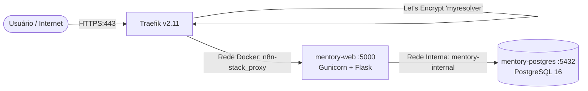

# Guia de Deploy em Produção na VPS (Traefik + GitHub Actions CD)

Este documento detalha a arquitetura de produção do Mentory na VPS Hostinger sob o domínio `mentory.stack-n8n.cloud`, com terminação TLS/HTTPS automática pelo Traefik e deploy contínuo (CD) via GitHub Actions.

---

## 1. Arquitetura de Produção

A infraestrutura na VPS foi projetada para conviver harmoniosamente com outros serviços em execução (como o Traefik v2.11 e o n8n), sem interferir nas portas e sem compartilhar volumes de banco de dados:



### Principais Características
- **Isolamento de Banco de Dados:** O Mentory possui seu próprio container PostgreSQL (`mentory-postgres`) com volume nomeado (`mentory_pgdata`) e rede interna dedicada (`mentory-internal`), sem expor a porta 5432 para o host.
- **Roteamento Inteligente via Traefik:** O container `mentory-web` se conecta à rede externa `n8n-stack_proxy` com as etiquetas (*labels*) `Host(\`mentory.stack-n8n.cloud\`)`, `entrypoints=websecure` e `certresolver=myresolver`. O Traefik emite e renova os certificados SSL/TLS automaticamente via Let's Encrypt.
- **Segurança e Cookies:** A aplicação roda com `SECURE_COOKIES=true` e valida o cabeçalho `X-Forwarded-Proto: https` enviado pelo Traefik.
- **Servidor WSGI de Produção:** A aplicação roda com **Gunicorn** (2 workers) com logs direcionados para stdout/stderr do Docker.

---

## 2. Configuração Inicial na VPS (Passo Único)

Acesse sua VPS via SSH e execute os seguintes passos na primeira vez:

### Passo 2.1: Clonar o repositório
```bash
git clone https://github.com/ProjetoIntegradorUMC/projeto-integrador.git /root/projeto-integrador
cd /root/projeto-integrador
```

### Passo 2.2: Criar e preencher o arquivo `.env.prod`
```bash
cp .env.prod.example .env.prod
nano .env.prod
```

Preencha os valores:
- `DB_ADMIN_PASSWORD`: gere uma senha forte para o admin do banco.
- `DB_APP_PASSWORD`: gere uma senha forte para a aplicação.
- `SECRET_KEY`: chave de 32 bytes gerada via Python:
  ```bash
  python3 -c "import secrets; print(secrets.token_hex(32))"
  ```
- `TOTP_ENCRYPTION_KEY`: chave Fernet gerada via Python:
  ```bash
  python3 -c "from cryptography.fernet import Fernet; print(Fernet.generate_key().decode())"
  ```
- Configure as credenciais de SMTP para envio de e-mails de recuperação.

### Passo 2.3: Iniciar os containers pela primeira vez
```bash
docker compose -f docker-compose.prod.yml up -d --build
```

Verifique se os containers subiram:
```bash
docker ps
```
Você verá `mentory-postgres` e `mentory-web` rodando. Em instantes, o Traefik emitirá o certificado e o sistema estará acessível em `https://mentory.stack-n8n.cloud`.

---

## 3. Configuração do Deploy Automático (GitHub Actions CD)

A cada Pull Request aprovada e mergeada na branch `main`, o GitHub Actions executa os testes automatizados e atualiza a VPS via SSH.

### Configurar Secrets no Repositório do GitHub:
No GitHub, vá em **Settings** > **Secrets and variables** > **Actions** > **New repository secret** e adicione:

1. `VPS_HOST`: `72.62.106.100` (IP da VPS)
2. `VPS_USERNAME`: `root` (ou o usuário com permissão de Docker na VPS)
3. `VPS_SSH_KEY`: Conteúdo da sua chave privada SSH (ex.: `~/.ssh/id_rsa` ou `id_ed25519`).
4. `VPS_PORT`: `22` (opcional, padrão 22).

---

## 4. Fluxo de Atualização Contínua (Zero Toque)

1. Um desenvolvedor abre uma PR com melhorias ou correções.
2. A equipe revisa e aprova a PR.
3. Ao clicar em **Merge pull request** na `main`:
   - O robô do GitHub roda a suíte de testes (`pytest -v`).
   - Se os testes passarem, o robô conecta na VPS via SSH.
   - Atualiza o código (`git pull`) e recria os containers (`docker compose -f docker-compose.prod.yml up -d --build`).
   - O Traefik mantém o tráfego HTTPS sem interrupção.
