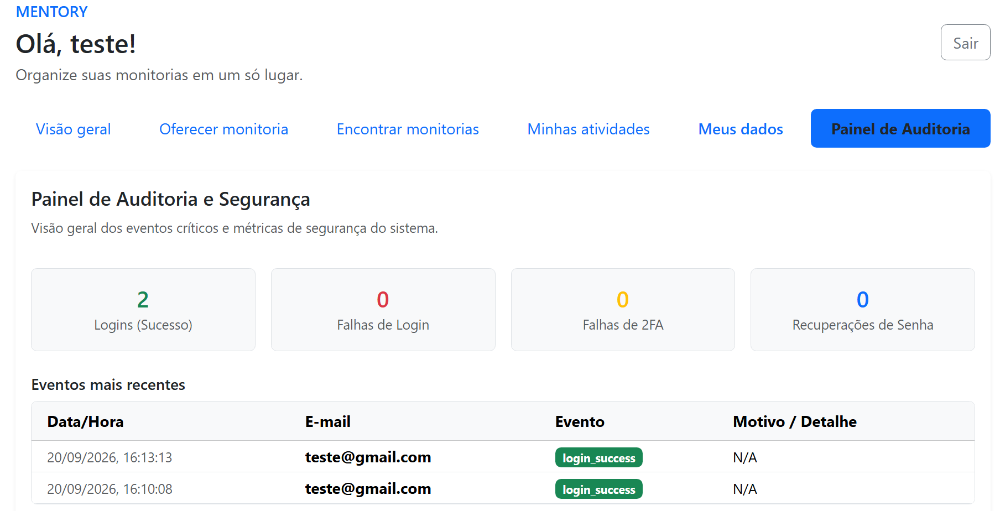
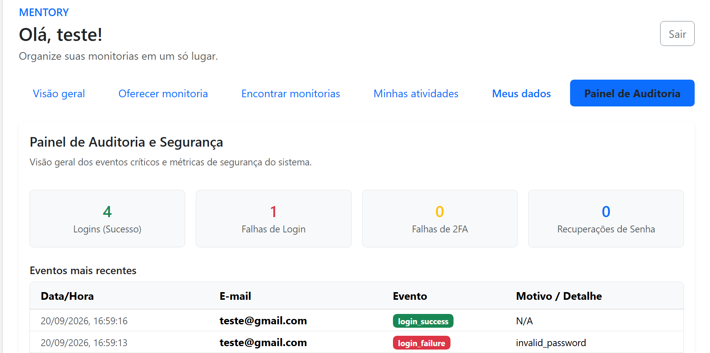
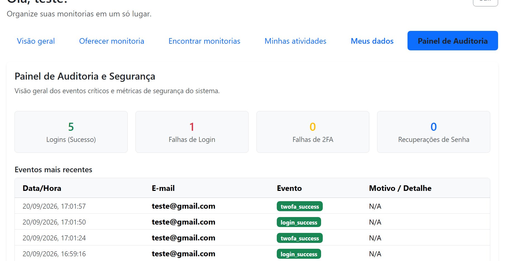
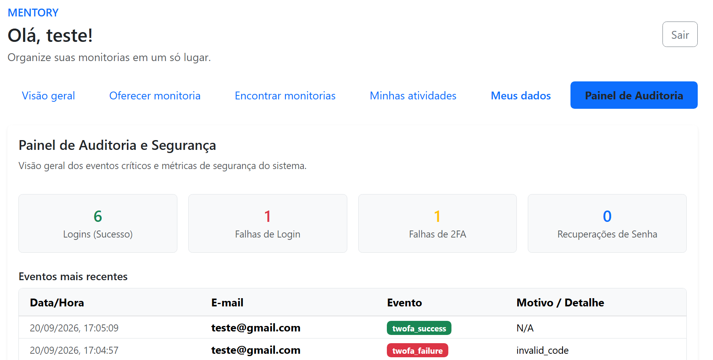
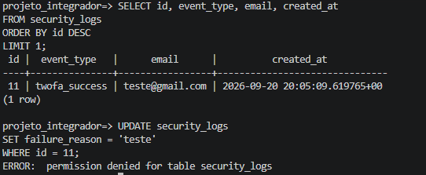
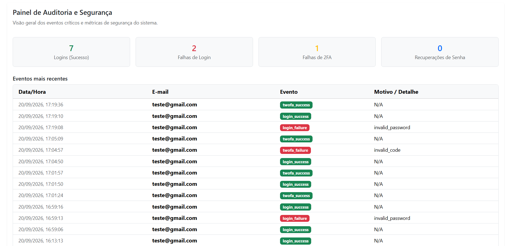

# Evidências: Auditoria e Logs

Este documento apresenta os testes realizados para validar o registro e a
visualização de eventos de segurança da plataforma Mentory.

## 1. Login com sucesso

### Passo a passo

1. Acessar a tela de login pelo frontend.
2. Informar um e-mail cadastrado.
3. Informar a senha correta.
4. Realizar o login.
5. Acessar o Painel de Auditoria.
6. Verificar o registro do evento de login bem-sucedido.

### Evidência



---

## 2. Login com falha

### Passo a passo

1. Sair da conta.
2. Acessar novamente a tela de login.
3. Informar um e-mail cadastrado.
4. Informar uma senha incorreta.
5. Confirmar que o acesso foi recusado.
6. Acessar o Painel de Auditoria após realizar um login válido.
7. Verificar o registro do evento de falha no login.

### Evidência



---

## 3. Validação do 2FA com sucesso

### Passo a passo

1. Configurar o 2FA para a conta utilizada nos testes.
2. Confirmar a configuração utilizando um código válido.
3. Sair da conta.
4. Realizar o login novamente.
5. Informar o código 2FA válido.
6. Confirmar o acesso à plataforma.
7. Verificar o registro do evento de sucesso do 2FA no Painel de Auditoria.

### Evidência



---

## 4. Falha na validação do 2FA

### Passo a passo

1. Sair da conta.
2. Realizar o login novamente.
3. Informar um código 2FA inválido.
4. Confirmar que o acesso não foi concluído.
5. Realizar um novo login com código válido.
6. Acessar o Painel de Auditoria.
7. Verificar o registro da falha na validação do 2FA.

### Evidência



---

## 5. Proteção contra alteração dos logs

### Passo a passo

1. Acessar o banco de dados utilizando o usuário da aplicação.
2. Selecionar um registro existente da tabela de logs.
3. Tentar alterar o registro.
4. Confirmar que a operação é recusada pelo PostgreSQL.
5. Tentar excluir o registro.
6. Confirmar que a operação também é recusada.

### Evidência (Ambiente Local)



### Evidências de Produção na VPS (`mentory.stack-n8n.cloud`)

Para comprovar que o provisionamento de privilégios restritos (*append-only*) e a validação de permissões foram executados e permanecem ativos no ambiente de produção (`srv1220910`), foram capturadas as quatro verificações abaixo diretamente nos containers de produção (`mentory-web` e `mentory-postgres`):

#### 5.1 Execução de `backend/db/provision.sh` e validação via `validate_permissions.sql`

```text
root@srv1220910:~/projeto-integrador# cd /root/projeto-integrador && docker compose -f docker-compose.prod.yml exec mentory-web bash -c "bash backend/db/provision.sh"
==> Criando ou atualizando schema pelos models...
Schema criado ou atualizado a partir dos models.
==> Aplicando privilégios da role de runtime...
NOTICE:  role "mentory_app" has already been granted membership in role "mentory_app_role" by role "mentory_admin"
NOTICE:  relation "log_retention_exemptions" already exists, skipping
==> Validando permissões efetivas...
    role_name     | schema_usage | schema_create | users_crud | tutoring_offers_crud_for_lgpd | enrollments_write | sessions_crud | password_reset_tokens_crud | rate_limit_counters_crud | security_logs_append | security_logs_mutation | password_reset_logs_append | password_reset_logs_mutation 
------------------+--------------+---------------+------------+-------------------------------+-------------------+---------------+----------------------------+--------------------------+----------------------+------------------------+----------------------------+------------------------------
 mentory_app_role | t            | f             | t          | t                             | t                 | t             | t                          | t                        | t                    | f                      | t                          | f
(1 row)
```

A matriz de validação confirma que a role de execução da aplicação (`mentory_app_role`) possui permissão de inserção e leitura nos logs (`security_logs_append = t` e `password_reset_logs_append = t`), mas **não possui permissão de mutação ou exclusão** (`security_logs_mutation = f` e `password_reset_logs_mutation = f`), além de estar impedida de criar objetos no schema (`schema_create = f`).

#### 5.2 Verificação de propriedade (`tableowner`) das tabelas de auditoria

```text
root@srv1220910:~/projeto-integrador# docker compose -f docker-compose.prod.yml exec mentory-postgres psql -U mentory_admin -d mentory -c "SELECT tablename, tableowner FROM pg_tables WHERE tablename IN ('security_logs', 'password_reset_logs');"
      tablename      |  tableowner   
---------------------+---------------
 password_reset_logs | mentory_admin
 security_logs       | mentory_admin
(2 rows)
```

Ambas as tabelas pertencem exclusivamente ao usuário administrativo (`mentory_admin` / `DB_ADMIN_USER`), impedindo que a conta de runtime da aplicação (`mentory_app` / `DB_APP_USER`) utilize privilégios de proprietário para contornar as restrições ou conceder novas permissões a si mesma.

#### 5.3 Bloqueio efetivo de `UPDATE` e `DELETE` com `DB_APP_USER` (`mentory_app`)

```text
root@srv1220910:~/projeto-integrador# docker compose -f docker-compose.prod.yml exec mentory-postgres psql -U mentory_app -d mentory -c "UPDATE security_logs SET event_type = 'tampered' WHERE id = 1;" -c "DELETE FROM password_reset_logs WHERE id = 1;"
ERROR:  permission denied for table security_logs
ERROR:  permission denied for table password_reset_logs
```

O PostgreSQL recusa imediatamente qualquer tentativa de adulteração (`UPDATE`) em `security_logs` ou remoção (`DELETE`) em `password_reset_logs` originada pela credencial da aplicação (`mentory_app`).

---

## 6. Painel de Auditoria

### Passo a passo

1. Acessar o sistema com a conta autorizada para o painel.
2. Abrir o Painel de Auditoria.
3. Verificar as métricas de eventos.
4. Verificar a lista de eventos recentes.
5. Confirmar a presença dos eventos gerados durante os testes.

### Evidência



---

## Validação pelo frontend

Os cenários de login e validação do 2FA foram realizados por meio da
interface do frontend.

A tentativa de alteração dos registros de auditoria é realizada diretamente
no banco de dados, pois tem como objetivo validar a proteção das tabelas
contra alterações pelo usuário da aplicação.